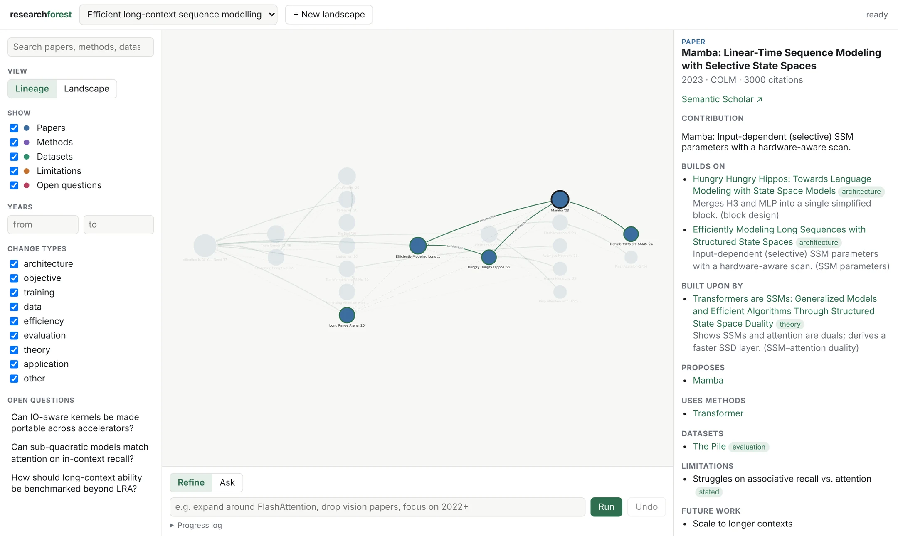
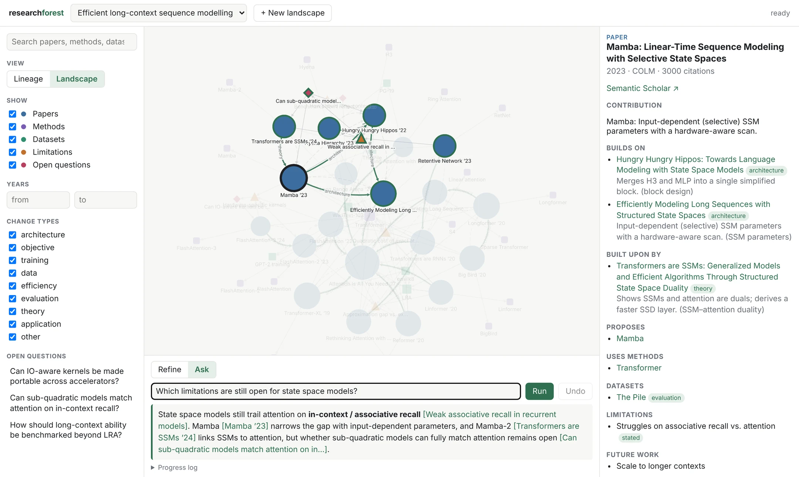
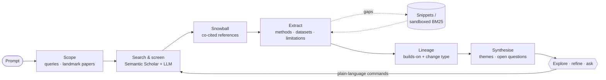

<div align="center">


# 🌲 research-forest

**Map a research field as a living graph: the papers, what each one builds on, and what is still open.**


[Getting started](docs/getting-started.md) · [Usage](docs/usage.md) · [How it works](docs/how-it-works.md) · [Security](docs/security.md)

</div>

<picture>
  <source media="(prefers-color-scheme: dark)" srcset="docs/assets/screenshot-lineage-dark.webp">
  
</picture>

Describe a research area in one sentence. research-forest finds the papers that matter and
traces **who builds on whom, and what each paper changes**. It also extracts the **methods**,
**datasets** and **limitations** of the field, and distils them into **open research
questions**. You then shape the graph in plain language, or ask it questions.

## Highlights

|  |  |
|---|---|
| 🧬 **Lineage, not just citations** | Every builds-on edge records *what* changed: architecture, objective, training, data, efficiency, evaluation, theory or application. |
| 🔬 **Structured extraction** | Methods, datasets, limitations (*stated*, *citing* or *inferred*) and future work for every paper. |
| 🎯 **Reads only what it needs** | Starts from the abstract and the citation contexts. Missing details are found through snippet search or sandboxed BM25 passage search, never by reading whole papers. |
| 🧭 **Open questions** | Limitations are clustered into themes. Each theme is linked to the papers that have it and the papers that address it, and the themes are turned into open research questions. |
| 💬 **Refine in plain language** | *"expand around FlashAttention"*, *"drop vision papers"*, *"only since 2021"*. Only new work is computed, and every step can be undone. |
| 🔎 **Search and Q&A** | Instant keyword search over every node, plus answers that cite nodes in the graph. |
| 🔌 **Bring your own model** | Any OpenAI-compatible API (OpenAI, vLLM, Ollama, …), the Claude Code CLI or the Codex CLI. |
| 🛡️ **Hardened by default** | Prompt-injection containment, a sandboxed full-text worker with an SSRF guard, a token-authenticated UI with a strict CSP. |

## Quickstart

```bash
pip install -e .
cp .env.example .env                               # secrets: OPENAI_API_KEY, S2_API_KEY (optional)
cp research-forest.example.toml research-forest.toml   # optional: backend, model, graph size, …

research-forest serve               # opens on http://127.0.0.1:8000/?token=…
```

Enter a prompt such as *"Efficient attention mechanisms for long-context transformers"* and
click **Build graph**. Prefer the terminal? Use `research-forest build "<prompt>"`. Just want a
look? `python scripts/demo.py` serves an example landscape, with no API keys needed.

<picture>
  <source media="(prefers-color-scheme: dark)" srcset="docs/assets/screenshot-ask-dark.webp">
  
</picture>

## How it works



Each step runs incrementally. Every paper is analysed once, every citation pair is judged once,
and LLM responses are cached on disk. [Read the details →](docs/how-it-works.md)

## Documentation

| | |
|---|---|
| [Getting started](docs/getting-started.md) | Install, choose a backend, first build, platform support |
| [Using the explorer](docs/usage.md) | UI tour, refinement commands, Q&A, CLI reference |
| [How it works](docs/how-it-works.md) | Pipeline, graph model, change types, gap filling, cost |
| [Configuration](docs/configuration.md) | Every setting and environment variable |
| [Security](docs/security.md) | Threat model, injection defences, sandbox, residual risks |
| [Development](docs/development.md) | Code layout, tests, extending backends and sources |
