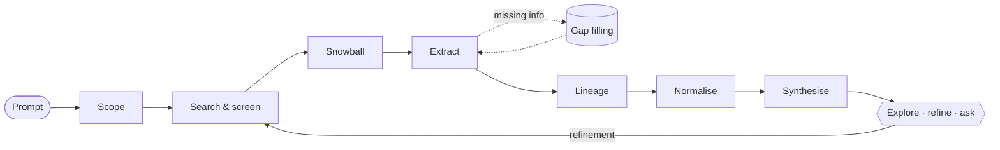

# How it works

## Pipeline

1. **Scope.** The LLM turns your prompt into a title, boundaries (include and exclude criteria),
   4–8 keyword queries, a few landmark paper titles and an optional start year.
2. **Search and screen.** Queries and title matches run against Semantic Scholar. The LLM rates
   each candidate's relevance from 0 to 3, in batches of 25. Landmark papers it named itself
   start at 3.
3. **Select.** About 60% of the paper budget is filled from the ranked candidates. Ranking
   combines relevance, *citations per year since publication* (raw totals would favour old
   papers) and how often papers already in the graph cite the candidate.
4. **Snowball.** References of the graph are fetched together with their *citation contexts*
   (the sentences in which one paper cites another) and intents. References cited by two or more
   graph papers are screened and added. The rest of the budget is then topped up from the
   relevant candidates.
5. **Extract.** For every paper, the LLM extracts:
   - the contribution;
   - methods proposed and used;
   - datasets, with how they're used;
   - limitations, each marked *stated* (by the authors), *citing* (reported by later papers) or
     *inferred*;
   - future work.

   Its inputs are the abstract (or the TL;DR when there is none) and two kinds of citation
   sentences. Both come free with the citation lists, at no extra cost:
   - **The paper's own sentences** where it cites other work. Semantic Scholar takes them from
     the paper's full text, and the ones that read like evaluation statements ("we evaluate on
     GLUE [12]") are the best evidence for datasets.
   - **Sentences from other papers** that describe this one. These are a rich source of
     limitations.
6. **Gap filling.** Abstracts usually name only headline benchmarks, so by default the full
   text is searched for datasets for every paper (`always_fill_datasets`). This lifted dataset
   recall on the gold set from 68% to 82%. Limitations and methods are gap-filled when the model
   flags them as missing or returns them empty. Passages come from the paper's text (see
   [below](#gap-filling)). A small follow-up call fills *only* those fields from the passages,
   and the results are merged in.
7. **Lineage.** Each citation between two graph papers is judged once: does the citing paper
   *build on* the cited one? If so, the edge gets a change type, the component that changed and
   a one-sentence summary. Pairs are batched (up to 15 per call) around a shared anchor paper.
   During a build that is usually the citing paper. After a refinement adds papers, it is usually
   the new papers, so older papers that cite them aren't re-sent one by one.
8. **Normalise.** Duplicate methods and datasets are merged ("WT103" → "WikiText-103"). Exact
   duplicates are merged by key; aliases by one LLM call per entity type. After the first run,
   only *new* names are sent, together with existing names that share a word, a number or
   initials with them.
9. **Synthesise.** Limitations from all papers are grouped into 5–15 **themes**. Each theme is
   linked to the papers that have it and to the papers that address it. From these themes come
   5–12 **open research questions**, each linked to its motivating themes and relevant papers.

## Lineage and change types

| Change type | Meaning |
|---|---|
| `architecture` | Changes model structure or components |
| `objective` | Changes the loss, the training objective or the problem formulation |
| `training` | Changes optimisation, schedule, fine-tuning or training procedure |
| `data` | Changes training data, augmentation or data collection |
| `efficiency` | Same goal, but cheaper, faster or smaller |
| `evaluation` | New benchmark, metric or evaluation protocol |
| `theory` | Theoretical analysis or explanation of the prior work |
| `application` | Applies the prior method to a new domain or task |
| `other` | None of the above |

Adopting and modifying, extending, re-implementing more efficiently, or replacing a component
all count as *builds on*. Background citations, comparison baselines and shared datasets do not.

## Graph model

| Node | Id | Created by |
|---|---|---|
| Paper | `p:<Semantic Scholar id>` | Search, snowball, refinement |
| Method, dataset | `e:<n>` | Extraction (then normalised) |
| Limitation theme, open question | `e:<n>` | Synthesis (rebuilt after each change) |

| Edge | From → to | Data |
|---|---|---|
| `cites` | paper → paper | citation contexts, intents, influential flag |
| `builds_on` | paper → paper | change type, component, summary |
| `proposes` / `uses` | paper → method | – |
| `evaluates_on` | paper → dataset | usage (training, evaluation, both) |
| `has_limitation` / `addresses` | paper → limitation theme | – |
| `motivates` | limitation theme → question | – |
| `about` | question → paper | – |

Everything lives in SQLite: papers, entities, edges, an FTS5 search index and snapshots for
undo.

## Gap filling

When an abstract doesn't name the datasets or limitations, research-forest tries two sources
in order:

1. **Semantic Scholar snippet search.** Full-text snippets from S2's index, queried per missing
   field. Extra search terms suggested by the LLM are added to each query.
2. **Local BM25 search.** If S2 has no snippets, the paper's text is downloaded in a
   [sandboxed worker](security.md#sandboxed-full-text-processing), trying sources in order:
   - **arXiv's HTML rendering** (`arxiv.org/html/<id>`), which also exists for most older papers.
     Its tables come through as rows ("BigBird | 75.7 | 86.8"), and the bibliography, author
     blocks and math markup are dropped. That matters because datasets are usually named in
     tables and captions, which PDF text extraction scrambles.
   - the open-access PDF;
   - the arXiv PDF.

   Pages without an HTML rendering fall through to the next source. The worker splits the
   text into overlapping windows of 120 words and ranks them with BM25, a standard
   keyword-ranking algorithm.

Both searches add the dataset and method names already used most in the graph to their
queries. If several papers evaluate on LRA or PG-19, passages naming those rank first.

Only the top passages are sent to the LLM, together with the title and the one-line
contribution, but not the abstract or citation contexts again. **Deepen** does this for every
field and reuses the existing extraction.

## Incremental processing and cost

Work is tracked so that refinements only pay for what is new:

| Step | Runs |
|---|---|
| Citation links | once per paper |
| Extraction | once per paper (again on `deepen`) |
| Builds-on judgement | once per citation pair |
| Normalisation | when new methods or datasets appeared; only new names plus likely aliases are sent |
| Synthesis | after a build, and after refinements that changed the papers (or asked for it) |

LLM responses are cached on disk, keyed by backend, model, prompt and schema, so re-running an
identical step costs nothing.

A 60-paper build makes roughly 60 extraction calls, up to 60 lineage calls, 5–15 screening
calls, plus a few scope, normalisation and synthesis calls. Papers with gaps take one extra
small gap-fill call.

### Keeping prompts lean

Prompt size is budgeted per item (see the constants at the top of `prompts.py`):
- Each abstract and set of citation contexts is sent once. The TL;DR is only used when there
  is no abstract, and repeated citation sentences are deduplicated.
- Lineage prompts carry two short citation contexts and a short contribution per pair.
- Q&A sends the relevant part of the graph, not the whole graph. Method and dataset links are
  inlined into paper lines, plain citations are left out, and open questions are only attached
  when the question is about gaps or the questions are linked to the hits.
- Follow-up questions re-use the nodes the previous answer cited, plus the previous question.
  The previous answer itself is never re-sent, so context doesn't pile up over a conversation.
- Schemas are sent as compact JSON, without descriptions that only repeat the prompt.

As a reference point, a synthetic 65-paper build plus a refinement and three questions dropped
from about 406k to 292k prompt tokens with these measures, roughly 28% less.

The `claude-code` backend adds about 2k tokens of fixed CLI overhead per call. Most of it is
served from Claude's prompt cache after the first call.

## Structured output

Every call requests a strict JSON schema, generated from Pydantic models with all fields
required and no extra properties. The output is validated, and invalid output is retried with
the error fed back to the model. Each backend gets the schema in the form it supports:

- `openai`: `response_format: json_schema` (strict). It falls back automatically to non-strict
  mode, then to `json_object`, then to a plain-text instruction for servers that don't support
  the stricter modes.
- `claude-code`: `claude -p --output-format json --json-schema …`
- `codex`: `codex exec --output-schema …`
